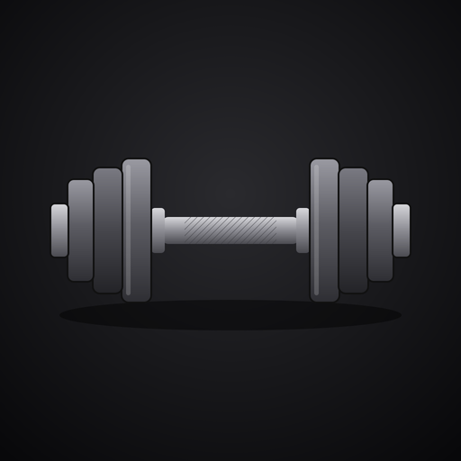
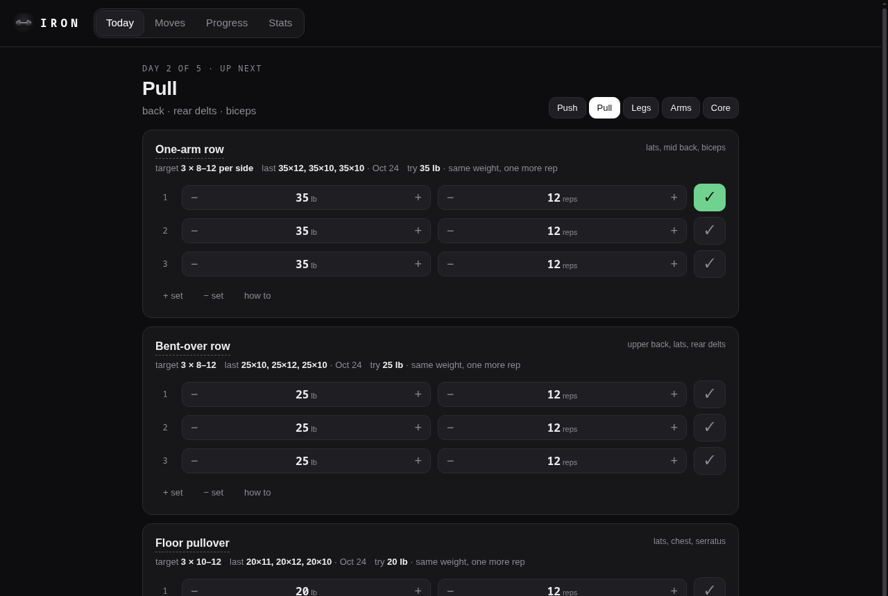
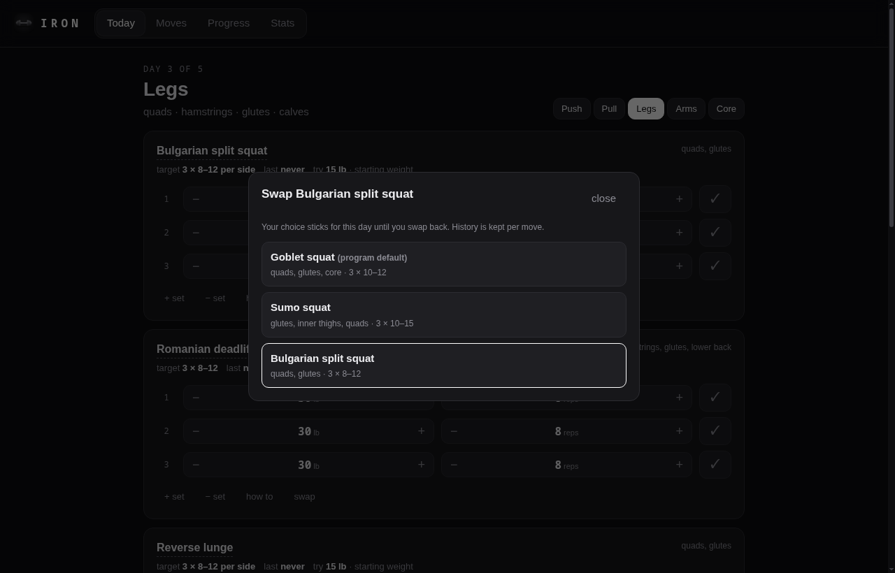
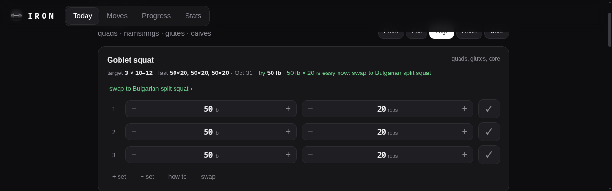
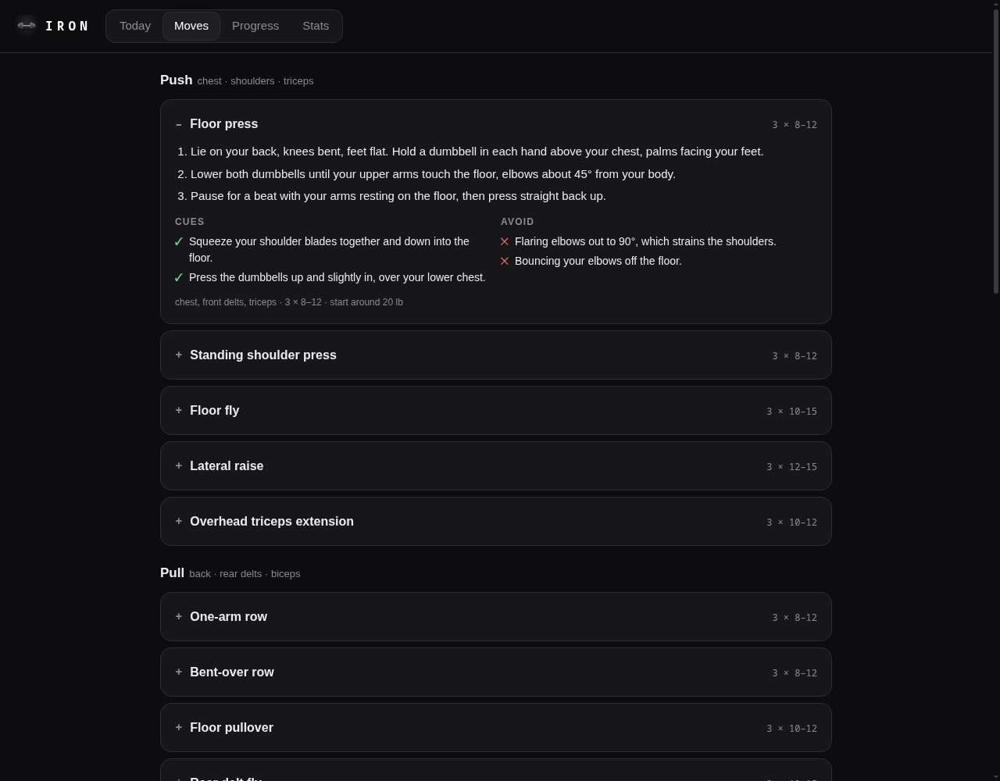
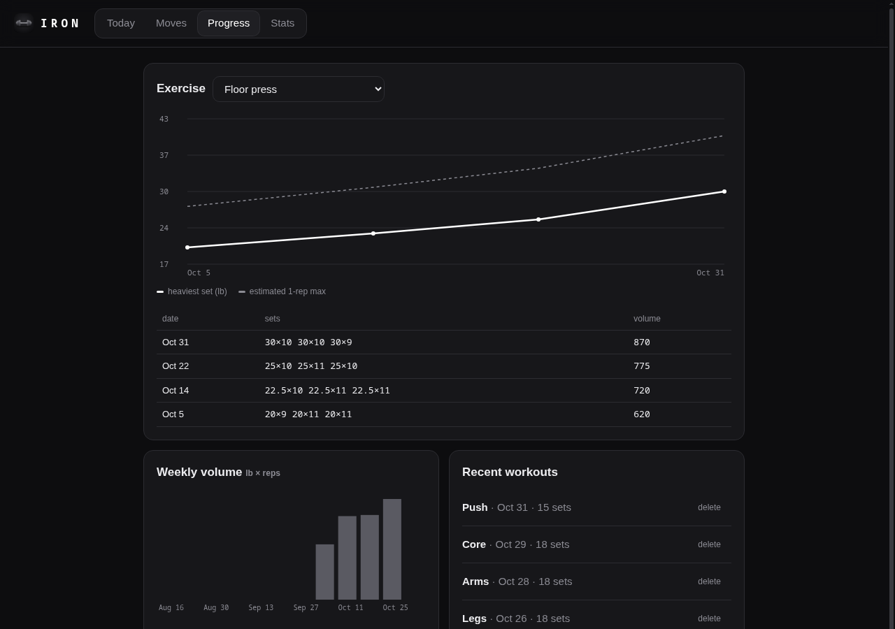
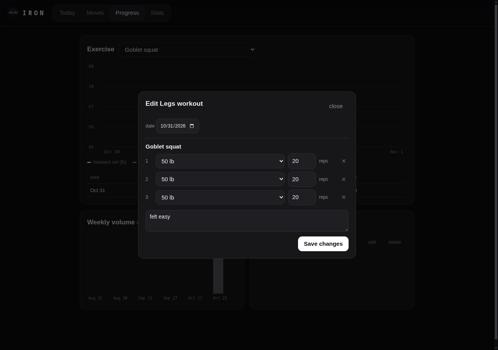
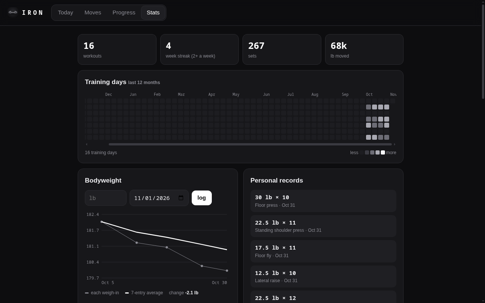
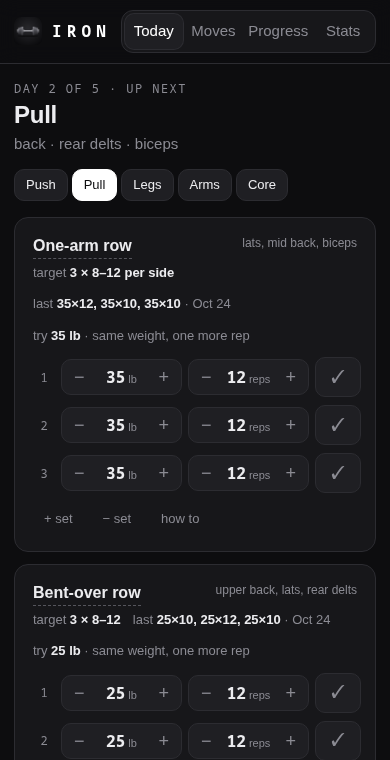

<p align="center">
  
</p>

<h1 align="center">%iron</h1>

<p align="center">
  A dumbbell workout tracker that lives on your Urbit ship.<br>
  One pair of adjustable dumbbells (5–50 lb), a 5-day split, and your whole training history.
</p>



## What it does

### The program

A 5-day split that **cycles**: finish a workout and Iron moves on to the next day. Train on whatever days suit you and you never lose your place. Everything uses one pair of adjustable dumbbells and the floor; no bench needed.

| Day | Moves |
|---|---|
| **Push** | floor press, standing shoulder press, floor fly, lateral raise, overhead triceps extension |
| **Pull** | one-arm row, bent-over row, floor pullover, rear delt fly, shrug |
| **Legs** | goblet squat, Romanian deadlift, reverse lunge, split squat, glute bridge, calf raise |
| **Arms** | biceps curl, hammer curl, skull crusher, kickback, concentration curl, Zottman curl |
| **Core** | Russian twist, dead bug, renegade row, weighted crunch, side bend, suitcase hold |

There are also **16 alternatives**, including bodyweight moves like push-ups and harder variations like Bulgarian split squats and single-leg RDLs. Any slot can be **swapped**, and your choice sticks for that day.

### Today

- Each move shows its target (e.g. 3 × 8–12 per side), **what you did last time**, and a **suggested weight**.
- It uses *double progression*: hit the top of the rep range on every set and it suggests the next dumbbell setting. Otherwise it's same weight, one more rep.
- **Past 50 lb:** once a move maxes out your dumbbells, the suggestion switches to adding reps (up to 20), then to a harder variation with a one-tap swap, or a slower tempo.
- Weight steppers snap to real adjustable-dumbbell settings (5, 7.5 … 25, 30 … 50).
- Tick a set and a **rest timer** pops up. It beeps or vibrates at the end, with +30 s and skip buttons.
- The screen stays awake while a workout is in progress, and a half-finished workout survives a refresh.
- **Back-date** a workout with the "done on" date if you trained without the app.

| Swap a move | Maxed out at 50 lb |
|---|---|
|  |  |

### Moves

Every exercise has numbered steps, ✓ cues, ✕ common mistakes, the muscles worked, and a sensible starting weight.



### Progress

- Pick any move to chart your **heaviest set** and **estimated one-rep max** over time, with a session log.
- See **weekly volume** and your recent workouts. Each one can be **edited** (sets, reps, date, notes) or deleted.

| Progress | Edit a workout |
|---|---|
|  |  |

### Stats

- Workouts, **week streak** (weeks with 2+ workouts), total sets and pounds moved.
- A GitHub-style **training grid** of the last 12 months.
- **Personal records** for every move.
- **Bodyweight** logging with a 7-entry average trend line.



### On your phone



Iron is built for logging between sets on a phone. Open it on your ship, then use your browser's **Add to Home Screen** (Safari: Share → Add to Home Screen; Chrome: ⋮ → Add to Home screen). It opens fullscreen like an app, with the dumbbell icon.

Weights are per dumbbell. Volume is weight × reps on that basis.

<br clear="right">

## Install

Iron isn't published from a ship yet, so you install it from this repo. You need a running ship and access to its pier folder on disk.

**1. Create and mount an empty desk.** In your ship's dojo:

```
|new-desk %iron, =gall &
|mount %iron
```

This creates a folder called `iron` inside your pier.

**2. Copy the app into it.** From a terminal:

```sh
git clone https://github.com/itsTylerIRL/iron
cp -r iron/desk/* <your-pier>/iron/
```

**3. Commit and install.** Back in the dojo:

```
|commit %iron
|install our %iron
```

**4. Open it.** Click the Iron tile on your Landscape home screen, or go to `/apps/iron` on your ship.

**To update later:** pull the repo, copy `desk/*` into `<your-pier>/iron/` again, and run `|commit %iron`. Your workouts are stored in the agent, so updating doesn't touch them.

<details>
<summary>Ship in Docker (GroundSeg / Native Planet)?</summary>

The pier lives inside the container, so copy the files in with `docker cp`:

```sh
docker cp iron/desk/. <container>:/urbit/<ship>/iron/
```

Then run `|commit %iron` and `|install our %iron` from that ship's dojo.
</details>

## How it works

| Piece | |
|---|---|
| `desk/app/iron.hoon` | The agent. Stores workouts, bodyweights and settings, and serves the page and an owner-only JSON API under `/apps/iron/api`. Weights are kept in tenths of a pound. |
| `desk/web/data.js` | The program, all 44 moves with their guides, the swap options and harder variations, and the dumbbell weights. Edit this to change the training. |
| `desk/web/app.js` | The four tabs, progression logic, rest timer, charts and training grid. |

Nothing leaves your ship; there are no outside services.

### API

All routes need you to be logged in to your ship.

| Route | |
|---|---|
| `GET /apps/iron/api/state` | workouts, bodyweights, settings |
| `POST /apps/iron/api/workout` | `{day, note, at?, entries: [{ex, sets: [{lbs, reps}]}]}` (lbs in tenths) |
| `POST /apps/iron/api/workout/<id>` | replace a workout (edit or re-date) |
| `DELETE /apps/iron/api/workout/<id>` | delete a workout |
| `POST /apps/iron/api/weight` | `{lbs, at?}` |
| `DELETE /apps/iron/api/weight/<id>` | delete a weigh-in |
| `POST /apps/iron/api/settings` | rest time and swaps (JSON, up to 4 kB) |

## Development

On a fake ship or comet, after steps 1–3 above, `./dev.sh <pier-dir> <tmux-session>` copies `desk/` in and commits it.

## License

MIT. See [LICENSE](LICENSE).
